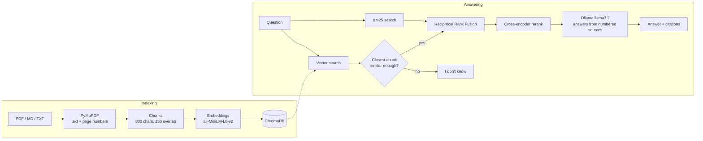

# Grounded AI Knowledge Assistant

Ask questions about your PDFs and documents and get answers **with citations**
(file and page). When the documents don't contain the answer, it says
**"I don't know"** instead of guessing.

It runs entirely on your own machine for free: local models, no API keys.


## Features

- **Cited answers.** Every claim points to a source, and you can expand the
  citation to read the exact passage and page.
- **Hybrid search.** Vector search (meaning) and BM25 (exact words) are merged with
  Reciprocal Rank Fusion, then a cross-encoder reranks the results.
- **Refuses instead of guessing.** Off-topic questions are rejected before the model
  is called, and the model is told to answer "I don't know" when the sources are silent.
- **Measured, not claimed.** A 70-question benchmark compares search strategies,
  and CI fails if search quality drops.
- **Full-stack app.** FastAPI backend, React frontend, user accounts with JWT, private
  chat history, and an evaluation dashboard.

## Results

Measured with `python -m evaluation.run retrieval` on 70 questions over 7 documents
(58 answerable, 12 whose answer is not in the documents). Each question is labelled
with an evidence phrase that must appear in the retrieved chunk.

| Search mode | Recall@1 | Recall@5 | MRR@5 | Latency p50 |
|---|---:|---:|---:|---:|
| Semantic (vectors only) | 81.0% | 100% | 0.890 | 33 ms |
| Hybrid (vectors + BM25, RRF) | 82.8% | 100% | 0.908 | 30 ms |
| **Hybrid + rerank** (default) | **94.8%** | 100% | **0.974** | 1,976 ms |

**What this shows**

- Every mode finds the right passage somewhere in the top 5. The difference is
  **ranking**: reranking puts the right passage *first* 94.8% of the time instead of
  81%. That matters because a small model mostly answers from the first sources.
- Reranking costs about **2 seconds per question on a laptop CPU**. That's worth it
  here, because generating the answer takes longer anyway; for a latency-critical
  service, hybrid without reranking is the cheaper option.
- 5 of the 12 unanswerable questions (the clearly off-topic ones, like "What is the
  capital of France?") are rejected before the model is called. The other 7 are
  near-misses, like *"What does Atlas error E4040 mean?"* when only other codes exist.
  They look relevant to search, so refusing them is the model's job.

**Answer quality** is measured with `python -m evaluation.run answers` on the same
70 questions, using hybrid + rerank and `llama3.2:3b` both to answer and to judge
(laptop CPU, no GPU).

| Metric | Result |
|---|---:|
| Correctness (answerable questions) | 96.6% (56 / 58) |
| Faithfulness to the sources | 94.8% (55 / 58) |
| Citation accuracy | 100% (58 / 58) |
| Refusal accuracy (unanswerable questions) | 100% (12 / 12) |
| Latency p50 / p95 | 28.8 s / 40.2 s |
| Tokens per question (in / out) | 790 / 23 |
| Cost per question | $0 (runs locally) |

- **Every unanswerable question got "I don't know"**, including the 7 near-misses
  that got past the search cutoff, so the prompt handles what the cutoff can't.
- **Faithfulness is the weakest score:** the judge marked 3 answers as not fully
  supported by the sources. Small models tend to add details, and the judge is
  the same small model, so treat this number as approximate.
- **Fixing the grader raised faithfulness from 89.7% to 94.8%.** Reading the
  failures showed the judge, not the answers, was often wrong: it marked
  paraphrases as incorrect and true extra details from the sources as made up.
  Clearer judge instructions with worked examples fixed that, and letting a
  question accept more than one evidence passage fixed a citation that pointed
  to a second valid page (98.3% → 100%). The answers themselves didn't change.
- **Latency is almost all generation** on a laptop CPU; search and reranking take
  about 2 seconds of it.

## Architecture



| Layer | Technology |
|---|---|
| Backend | Python 3.12, FastAPI, Pydantic |
| Documents | PyMuPDF |
| Embeddings / reranking | Sentence Transformers (`all-MiniLM-L6-v2`, `ms-marco-MiniLM-L-6-v2`) |
| Search | ChromaDB (vectors), rank-bm25 (keywords) |
| Answers | Ollama + `llama3.2:3b` (any Ollama model via one setting) |
| Accounts | SQLite + SQLAlchemy, Argon2 password hashing, JWT |
| Frontend | React, Vite, TypeScript, Tailwind CSS, Recharts |
| Quality | pytest, Vitest + Testing Library, Ruff, oxlint, GitHub Actions |
| Deployment | Docker, docker compose, Hugging Face Spaces |

## Design decisions and trade-offs

- **No LangChain or LlamaIndex.** Chunking, retrieval, fusion and prompting are each
  a few dozen lines of plain Python, so every step can be explained, tested and
  measured on its own.
- **Chunks never cross page boundaries**, so every citation points to a real page.
- **Evaluation labels are evidence phrases, not chunk IDs.** Changing the chunk size
  doesn't invalidate the dataset, and a test checks that every phrase really exists
  in its source document.
- **The "I don't know" cutoff (`min_score = 0.2`) was chosen from data.** Off-topic
  questions score 0.07–0.15 and the weakest answerable question scores 0.24, but one
  unanswerable near-miss scores 0.25. No single cutoff separates them, so the cutoff
  only catches the clearly off-topic questions and the model handles the rest.
- **Reciprocal Rank Fusion instead of mixing scores.** Cosine similarity and BM25
  scores are on different scales; RRF only uses ranks, so it needs no tuning.
- **Shared knowledge base, private history.** Any signed-in user can add documents;
  chat history is per user. Per-user document collections would be the next step for
  a multi-tenant product.
- **`temperature: 0`** makes answers repeatable, so benchmark runs are comparable.

## Run it locally

You need Python 3.11+, Node 22+ and [Ollama](https://ollama.com).

```bash
ollama pull llama3.2:3b
```

```bash
python -m venv .venv
.venv\Scripts\activate
pip install -r requirements-dev.txt
python -m app.cli ingest data/sample_docs
```

```bash
cd frontend
npm install
npm run build
cd ..
uvicorn app.main:app --reload
```

Open http://localhost:8000, create an account and ask a question. The API docs are at
http://localhost:8000/docs.

On a laptop with 8 GB of RAM, `llama3.2:1b` is noticeably faster. Set
`RAG_LLM_MODEL=llama3.2:1b` in a `.env` file (see `.env.example` for every setting).

**Frontend development** with hot reload: run `npm run dev` in `frontend/` while the
API runs on port 8000.

### With Docker

```bash
docker compose up --build
```

This starts the app and an Ollama container, and downloads the answer model on first
start. Set `RAG_JWT_SECRET` to a long random value before exposing it anywhere.

## Run the benchmark

```bash
python -m evaluation.run retrieval
python -m evaluation.run answers
python -m evaluation.run regrade
```

The first command needs no LLM. The second needs Ollama running and takes a few
minutes. The third grades the saved answers again without regenerating them, which
is useful after changing the judge. Results are saved to `evaluation/results/` and shown on the dashboard.
Questions live in `evaluation/questions.jsonl`.

## Tests

```bash
pytest
ruff check .
```

```bash
cd frontend
npm test
npm run lint
```

There are 120 backend tests and 12 frontend tests. They use a fake embedder and
model, so they run offline in seconds. CI also runs the retrieval benchmark with the
real models and **fails the build if Recall@5 drops below 90%**.

## API

| Method | Path | Auth | What it does |
|---|---|---|---|
| `POST` | `/api/auth/register` | | Create an account |
| `POST` | `/api/auth/login` | | Get a JWT (form fields `username`, `password`) |
| `GET` | `/api/auth/me` | ✔ | Current user |
| `POST` | `/api/documents` | ✔ | Upload a PDF, Markdown or text file |
| `GET` | `/api/documents` | ✔ | List documents |
| `DELETE` | `/api/documents/{doc_id}` | ✔ | Remove a document |
| `POST` | `/api/ask` | ✔ | `{"question": "...", "mode": "hybrid_rerank"}` returns an answer with citations |
| `GET` / `DELETE` | `/api/history` | ✔ | Your chat history |
| `GET` | `/api/evaluation` | | Benchmark results for the dashboard |

## Deploy

See [deploy/huggingface/README.md](deploy/huggingface/README.md) to host a free demo
on a Hugging Face Space.

## Project structure

```
app/            FastAPI app: ingestion, retrieval, RAG, auth, database
evaluation/     70-question benchmark, metrics, LLM judge, saved results
frontend/       React + Vite + TypeScript app
tests/          Backend tests
data/sample_docs/  Sample documents (the Atlas Sync manual is fictional)
scripts/        Generates the sample PDF
deploy/         Hugging Face Space setup
```

## Limitations

- **The benchmark corpus is small** (7 documents, about 20 chunks), so Recall@5
  saturates at 100%. A larger corpus, for example public research papers, would show
  bigger differences between modes.
- **The `min_score` cutoff was tuned on the same questions it's evaluated on**, so
  the rejection rate is optimistic.
- **The answer judge is the same small model** that writes the answers; a stronger
  judge would give more reliable faithfulness scores.
- **Scanned PDFs aren't supported** (they need OCR).
- **Not run yet:** the Docker image and the Hugging Face deployment. The Docker
  image is built by CI on every push.
